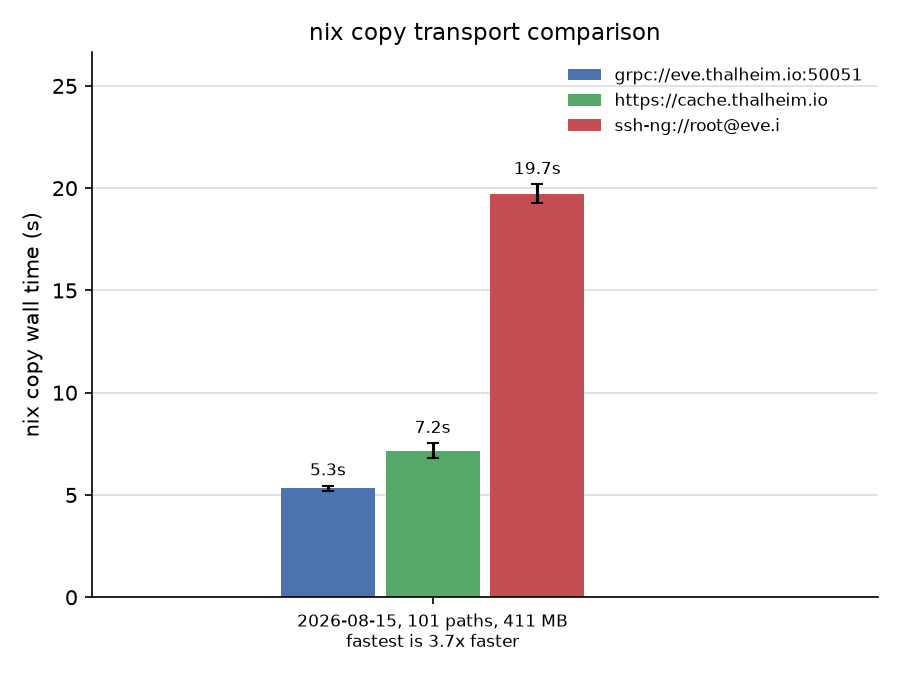
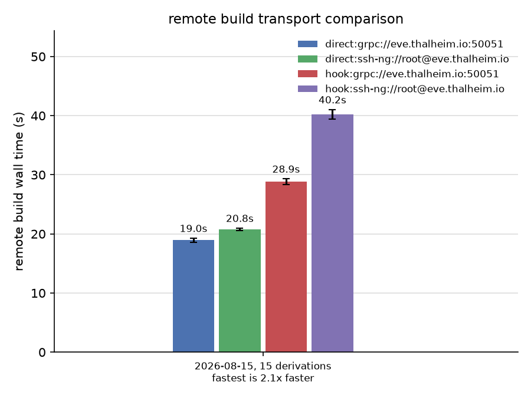

# nix-grpc-store

**Status: Stable.**

Remote Nix store access over gRPC instead of SSH. Over a WAN link
`nix copy` is 5.5x faster than with `ssh-ng://`. Path-info queries are
batched and NAR downloads are pipelined, so the wall time is bound by
bandwidth.

What gRPC changes compared to `ssh-ng://`:

  * `nix copy` tolerates latency. An RPC batches the path queries for a
    whole closure, and each connection downloads its NARs as a
    server-driven stream after one request. Copying 200 small paths at
    50 ms RTT takes 1.3 s. A client that needs a round trip per path
    takes 11.8 s.
  * Connections are cheap to open. A TLS handshake costs much less than
    an SSH connection setup, which starts a subprocess and a shell and
    negotiates keys and a session. Connections are multiplexed over
    HTTP/2, so frequent short-lived store operations start quickly.
  * Authentication uses X.509 certificates instead of SSH keys. An
    existing PKI works, for example a
    [step-ca](https://smallstep.com/docs/step-ca/) that issues
    short-lived client and server certs, and so do load balancers,
    service meshes and mTLS policies that already speak HTTP/2.
  * All traffic is zstd-compressed. A batch of paths shares a zstd
    stream, so the compression window spans all its NARs. ssh's optional
    zlib made the benchmark below slower.
  * It scales to a build farm and has run on clusters of 400 to 500
    machines. Point `builders =` or `--store` at a `grpc://` address and
    the daemons behind it spread the derivations over all nodes, like
    Hydra's queue runner but for any Nix client and without a database.
    A free slot goes to the user with the fewest builds running, so
    small builds get through while a large one is queued. See
    [docs/farm.md](docs/farm.md).

It is a full replacement for `ssh-ng://`. The gRPC layer is a thin
tunnel to the `nix-daemon` on the other side, with dedicated RPCs for
the `nix copy` hot path (path info queries, bulk import, NAR download).
[docs/latency.md](docs/latency.md) shows the round trips each operation
costs as sequence diagrams.

## Benchmark

### `nix copy`

The chart shows `nix copy` of a 101-path, 411 MB closure from the same
server over a wired link with ~47 ms RTT, with 10 interleaved runs per
transport.

A static HTTP binary cache is still faster, but it only serves
downloads. The gRPC store comes close and also handles uploads, remote
builds and mTLS on the same endpoint.

Reproduce with `./scripts/bench-transports.py`.

### Remote builds

There are two ways to build on a remote machine:

- In **hook** mode the machine is listed in `builders =`. For every
  derivation Nix spawns a fresh `build-remote` helper process that opens
  its own connections, uploads the inputs, runs the build and downloads
  the outputs.
- In **direct** mode the remote store is the target of the build (`nix
  build --store 'grpc://…'`). The same client process drives the whole
  build graph over a long-lived connection, and outputs stay on the
  remote store.

On a chain of tiny builds over a ~50 ms WAN link, grpc is 1.4x faster
than `ssh-ng://` in hook mode. A streaming RPC submits a derivation and
returns the result with its output path infos, while ssh-ng sets up an
ssh session for every derivation. In direct mode the transports are
comparable, since a long-lived connection serves the whole build either
way:

Reproduce with `./scripts/bench-builds.py`.

## Install

    nix build

This produces `result/bin/nix-grpc-daemon` for the server and
`result/lib/nix/plugins/nix-grpc-store-loader.so` for the client, which
dispatches to the plugin build matching the running Nix version.

For a client outside NixOS, `nix build .#nix-with-plugin` gives a `nix`
(and `nix-build`, `nix-store`, …) with the plugin already loaded. In
another flake, `nix-grpc-store.lib.wrapNix pkgs pkgs.nix` does the same
for any nixpkgs `nix`, for example to put into a CI image.

`nix-grpc-store.lib.nixToolsWithPlugin pkgs` returns `nix`,
`nix-eval-jobs` and `nix-fast-build` built from your `pkgs`, with the
plugin loaded in all of them. Use it in a dev shell, not in
`environment.systemPackages` (that would collide with `nix.package`):

    inputs.nix-grpc-store.inputs.nixpkgs.follows = "nixpkgs";
    # ...
    devShells.x86_64-linux.default =
      let
        pkgs = nixpkgs.legacyPackages.x86_64-linux;
        tools = nix-grpc-store.lib.nixToolsWithPlugin pkgs;
      in
      pkgs.mkShell {
        packages = [ tools.nix tools.nix-eval-jobs tools.nix-fast-build ];
      };

`nix build .#nix-tools-with-plugin` builds the same set from this flake's
nixpkgs.

## Quick start (NixOS)

Add the flake and enable the modules:

    # flake.nix inputs
    nix-grpc-store.url = "github:Mic92/nix-grpc-store";

    # server
    imports = [ nix-grpc-store.nixosModules.server ];
    services.nix-grpc-daemon.enable = true;
    services.nix-grpc-daemon.tls = { certFile = ./server.pem; keyFile = ./server.key; };

    # client
    imports = [ nix-grpc-store.nixosModules.client ];
    programs.nix-grpc-store.enable = true;

The client module ships plugin builds for the supported Nix versions and a
loader that picks the one matching the running Nix. The server module runs
the daemon as an unprivileged `nix-grpc-daemon` user and adds it to
`extra-allowed-users` so it can reach the local `nix-daemon` even when
`allowed-users` is restricted.

## Quick start (manual)

On the builder:

    nix-grpc-daemon --listen 0.0.0.0:50051

On the client, use `nix-with-plugin` (or add
`plugin-files = /path/to/lib/nix/plugins` to `nix.conf`) and use it like
any other store URI:

    nix store info --store 'grpc://builder:50051?insecure=1'
    nix build nixpkgs#hello --store 'grpc://builder:50051?insecure=1'
    nix copy --to 'grpc://builder:50051?insecure=1' ./result

The daemon proxies to the local `nix-daemon` socket, so gRPC clients get
whatever store privileges the uid running `nix-grpc-daemon` has.

## TLS and mTLS

Server:

    nix-grpc-daemon --listen 0.0.0.0:50051 \
        --tls-cert server.pem --tls-key server.key \
        --client-ca ca.pem              # optional: require client certs

Client:

    nix build --store \
      'grpc://builder:50051?ca-cert=ca.pem&client-cert=me.pem&client-key=me.key' ...

Without `--client-ca` any TLS client can connect. With it, only clients
presenting a certificate signed by that CA are accepted.

## Trust model

gRPC clients act as the `nix-grpc-daemon` user, which is not trusted by
default. That is enough for `nix build --store 'grpc://…'`, `nix copy` and
path queries. Sources and derivations are content-addressed, signed
cache paths are accepted, and the server builds everything itself.

A server that does not trust its clients therefore works as a builder
without further setup:

    nix build nixpkgs#hello --store 'grpc://builder:50051' --eval-store auto

Evaluation runs locally (`--eval-store auto` keeps the eval artifacts in
the local store instead of round-tripping them to the server). The
derivation closure is imported, which passes the signature checks
because sources and `.drv` files are content-addressed, and all builds
happen server-side. Everything that crosses the trust boundary is
content-addressed or signed, so `trustClients` can stay off.

Using the server as a remote builder (`builders = grpc://…`) is
different. There the *client* schedules builds and uploads input paths
it built locally. These are unsigned, and only trusted users may import
unsigned paths. Set `services.nix-grpc-daemon.trustClients = true` for
that. Every authenticated client then has trusted-user privileges, so
require client certs (`tls.clientCaFile`).

## Access control

With mTLS, `--allow 'pattern=role'` maps client certificate CNs or
SPIFFE IDs to roles via glob patterns. The first match wins and
unmatched clients are denied. Without any rules every authenticated
client gets `write`, or `trusted` with `--trust-clients` (`trustClients`
in the NixOS module). Once `--client-ca`, `--client-spiffe-bundles` or
`--oidc-config` is set, callers that present neither a certificate nor a
token are denied unless `--allow-anonymous` is given.

    nix-grpc-daemon ... --client-ca ca.pem \
        --allow 'ci-*=trusted' \
        --allow 'cache-mirror=read-only' \
        --allow '*=write' \
        --allow-anonymous read-only    # optional: cert-less clients

  * `read-only` allows path queries, NAR downloads (`nix copy --from`)
    and reading every build log the daemon's store keeps
    (`nix log --store`).
  * `write` also allows imports (signature checking is enforced
    regardless of `--no-check-sigs`) and server-side builds
    (`nix build --store 'grpc://…'`).
  * `trusted` allows everything, including the raw worker-protocol tunnel
    (`nix store add`, repair) and unsigned imports (still subject to
    the nix-daemon's trust in the proxy user, see above).

`--allow-anonymous ROLE` lets clients without a certificate connect with
that role (e.g. a public read-only cache). Certificate holders keep
their `--allow` roles. Rules on names rely on the CA to control who gets
which name. In [step-ca](https://smallstep.com/docs/step-ca/),
provisioners constrain which CNs each token may request.

`--trusted-proxy PATTERN` is for a TLS-terminating L7 balancer (envoy)
in front of the daemon. A peer presenting a certificate whose CN or
SPIFFE ID matches is a proxy. From such a peer the daemon takes the
client's identity from the `x-forwarded-client-cert` header the proxy
sets (`Subject` CN, evaluated against `--allow`) or a forwarded bearer
token, and treats the request as anonymous if neither is present. From
any other peer the header is ignored. The proxy must overwrite the
header (envoy `forward_client_cert_details: SANITIZE_SET`) and
authenticate to the daemon with its own client cert.

### SPIFFE IDs

A pattern that starts with `spiffe://` is matched against the client
certificate's SPIFFE ID (its single URI SAN) and never against the CN.
Its `*` matches within one path segment, so it matches neither a deeper
path nor another trust domain:

    nix-grpc-daemon ... --client-spiffe-bundles bundles.json \
        --allow 'spiffe://example.org/farm/client/*=trusted' \
        --allow 'spiffe://partner.example/mirror=read-only'

`--client-spiffe-bundles FILE` replaces `--client-ca` when the daemon
trusts more than one trust domain. The file is a SPIFFE bundle map
([gRFC A87](https://github.com/grpc/proposal/blob/master/A87-mtls-spiffe-support.md)):

    {"trust_domains": {
      "example.org":     {"keys": [{"kty": "EC", "use": "x509-svid", "x5c": ["<base64 DER>"]}]},
      "partner.example": {"keys": [{"kty": "EC", "use": "x509-svid", "x5c": ["<base64 DER>"]}]}
    }}

A client must then present an X.509-SVID whose chain leads to the bundle
of the trust domain in its SPIFFE ID. With `--client-ca` and one file
that holds both CAs, `partner.example`'s CA could sign
`spiffe://example.org/farm/client/x` and the daemon would accept it. A
certificate without a SPIFFE ID fails the handshake. The file is re-read
when it changes, so a federated bundle can rotate.

`--trusted-proxy` takes `spiffe://` patterns too. Behind such a proxy
the SPIFFE ID comes from the header's `URI` (envoy
`set_current_client_cert_details: {subject: true, uri: true}`), and the
proxy verifies the chain against the right trust domain.

NixOS:

    services.nix-grpc-daemon.accessRules = [
      { cn = "ci-*"; role = "trusted"; }
      { cn = "*"; role = "read-only"; }
    ];
    services.nix-grpc-daemon.anonymousRole = "read-only"; # optional

Role needed per use case:

| Use case                                         | Role        |
| ------------------------------------------------ | ----------- |
| Substituter, `nix copy --from`                   | `read-only` |
| `nix log --store 'grpc://…'`                     | `read-only` |
| `nix copy --to` (signed paths)                   | `write`     |
| `nix build --store 'grpc://…' --eval-store auto` | `write`     |
| Remote builder (`nix.buildMachines`)             | `trusted`   |
| `--repair`, `nix store add`                      | `trusted`   |

Builds are submitted through a dedicated RPC and run entirely
server-side, so the `write` role suffices. Only operations that tunnel
the raw worker protocol need `trusted`, and repair builds need `trusted`
like the other repair operations.

For host-based access, use a CA that issues certs with the host's domain
name in the CN, e.g. a [step-ca](https://smallstep.com/docs/step-ca/)
ACME provisioner with `forceCN = true`. Each host then obtains its
certificate via ordinary ACME (`security.acme`) and an `accessRules`
glob like `*.example.com = read-only` grants it substituter access. See
[`tests/acme-substituter-test.nix`](tests/acme-substituter-test.nix) for
a complete, tested NixOS setup (built as the `acme-vm` check).

### OIDC bearer tokens

Instead of (or next to) client certificates the daemon accepts
`authorization: Bearer <jwt>` and maps token claims to the same roles.
`--oidc-config FILE` takes the JSON schema of
[niks3](https://github.com/Mic92/niks3)'s `--oidc-config`, so the same file
can serve the cache and the daemon. The scope `read` gives the
role `read-only`, `write` gives `write` and `admin` gives `trusted`.

    {
      "providers": {
        "github": {
          "issuer": "https://token.actions.githubusercontent.com",
          "audience": "grpc://cache.example.com",
          "rules": [
            { "bound_subject": ["repo:myorg/*"], "scopes": ["write"] },
            { "bound_claims": { "repository_owner": ["myorg"], "ref": ["refs/heads/main"] }, "scopes": ["admin"] }
          ]
        },
        "k8s": {
          "audience": "grpc://cache.example.com",
          "ca_file": "/var/run/secrets/kubernetes.io/serviceaccount/ca.crt",
          "bearer_token_file": "/var/run/secrets/kubernetes.io/serviceaccount/token",
          "bound_claims": { "kubernetes.io.namespace": ["ci"] }
        }
      }
    }

Without `issuer`, the issuer is read from the token in
`bearer_token_file` (Kubernetes workload identity). `jwks_url` skips
discovery. Signing keys are fetched on first use and cached for an hour,
so the daemon can start while the issuer is down. It then refuses tokens
until the issuer is back. A presented client certificate takes
precedence over a token. Rules are alternatives. A token gets the
highest role of all rules it matches, so each rule must bind the
repository or owner on its own. Providers may share an issuer if their
audiences differ. A token is checked against the providers whose
audience it carries and gets the highest role among them, so a client
that asks for an audience of its own, such as a read-only mirror, is
checked only against that provider's rules. A verified token that
matches no rule is denied and does not fall back to `--allow-anonymous`.
In logs and metrics the caller appears as `oidc:<provider>:`.

Clients pass the token with the `token-file` URI parameter or
`$NIX_GRPC_TOKEN_FILE` (by default `token` next to the default
`client-cert`). The file is re-read for every call, so rotating it in
place works. TLS is required.

NixOS: `services.nix-grpc-daemon.oidc = { providers.github = { … }; };`

## Scaling out

A daemon on its own schedules builds onto itself. A farm puts several
nodes behind a balancer, one of them the scheduler, builds each
derivation once and stores the outputs in S3. See
[docs/farm.md](docs/farm.md) for NixOS and
[docs/kubernetes.md](docs/kubernetes.md) for the Helm chart.

## Remote builder

    nix.buildMachines = [{
      hostName = "grpc://builder:50051";
      protocol = null;
      systems = [ "x86_64-linux" "aarch64-linux" ];
      maxJobs = 64;
    }];

TLS uses the system CA bundle and the client key pair from
`/run/nix-grpc-store` or `/var/lib/nix-grpc-store` by default (see below).

With access rules, remote builders need the `trusted` role, because the
builder protocol imports unsigned outputs built on the client. Without
access rules, set `trustClients` (see above).

## URI parameters

  * `insecure` uses plaintext without TLS (testing only).
  * `ca-cert` is the PEM CA that verifies the server. It defaults to
    `$NIX_SSL_CERT_FILE`, `$SSL_CERT_FILE` or the system CA bundle.
  * `client-cert` and `client-key` are the PEM pair presented for mTLS.
    They default to `$NIX_GRPC_CLIENT_CERT`/`$NIX_GRPC_CLIENT_KEY`, then
    `client.crt`/`client.key` in `$XDG_DATA_HOME/nix-grpc-store`, then
    `/run/nix-grpc-store`, then `/var/lib/nix-grpc-store`. Unreadable
    candidates are skipped, and none is looked up when `token-file` is
    given.
  * `token-file` is an OIDC bearer token, re-read per call. It defaults
    to `$NIX_GRPC_TOKEN_FILE`, then `token` in the directories above.
  * `connect-timeout` (default 30) is how many seconds the first call
    keeps retrying "connection refused" and similar.
  * `restart-grace` (default 120) is how many seconds the client keeps
    retrying during a worker or scheduler restart once the server has
    answered, and how long it waits while the scheduler reports that no
    worker can take a build.
  * `reschedule-retries` (default 8) is how often a derivation whose
    assigned worker went away is handed back to the scheduler. The first
    retry is immediate, the next ones follow after 0.5 s, 1 s and 2 s,
    and all later ones after 4 s.
  * `max-builds` (default 64) limits concurrent `BuildDerivation`
    streams.
  * `system` sends `x-nix-system` on every call, so a balancer also
    routes input uploads and substitution to a worker of that system.
    Use one `nix.buildMachines` entry per system.
  * `debug` prints which CA bundle and client certificate were loaded
    and turns on gRPC's TCP/TLS handshake tracing on stderr.
    `NIX_GRPC_DEBUG=1` does the same and also applies to the build hook.

## Server flags

  * `--listen ADDR` defaults to `0.0.0.0:50051`.
  * `--proxy-socket PATH` is the nix-daemon socket, by default
    `/nix/var/nix/daemon-socket/socket`.
  * `--tls-cert`, `--tls-key` and `--client-ca` are described under
    [TLS and mTLS](#tls-and-mtls).
  * `--client-spiffe-bundles FILE` verifies clients per SPIFFE trust
    domain, see [SPIFFE IDs](#spiffe-ids).
  * `--allow 'pattern=role'`, `--allow-anonymous ROLE`, `--trust-clients`
    and `--trusted-proxy PATTERN` are described under
    [Access control](#access-control).
  * `--oidc-config FILE` accepts OIDC bearer tokens, see
    [OIDC bearer tokens](#oidc-bearer-tokens).
  * `--metrics-listen ADDR` serves Prometheus metrics, which are off
    by default.
  * `--worker-name NAME` is the name in build-log prefixes and
    `nix_grpc_build_info`, by default the hostname.
  * `--role builder,scheduler`, `--scheduler ADDR`,
    `--scheduler-token-file FILE`, `--advertise IP:PORT`,
    `--extra-system SYSTEM`, `--max-jobs N` and `--min-free SIZE` are
    described in [docs/farm.md](docs/farm.md). The defaults make a single
    node schedule onto itself.
  * `--lookup-threads N` is how many cache lookups a scheduler runs at
    once for incoming Wants, 32 by default. Raise it when Wants wait on a
    slow cache while the scheduler is idle.
  * `--niks3 URL [--niks3-token-file FILE] [--niks3-client-cert FILE --niks3-client-key FILE] [--niks3-push CMD]`
    publishes build outputs and uploads to a niks3 cache. The daemon
    authenticates with a bearer token, a client certificate (defaults to
    `--tls-cert/--tls-key`), or both.
  * `--log-level info|debug` sets the access log verbosity, `info` by
    default.

## Monitoring

All gRPC clients act as the same local user, so activity is attributed
to the client certificate CN, or to its SPIFFE ID when it has no CN
(`cn=-` without mTLS). If your CA puts a user name in the CN, logs and
metrics are per user.

### Access log

The daemon writes one logfmt line per RPC to stderr (journald):

    ts=2025-01-15T12:03:41Z level=info event=rpc method=Connect cn=alice peer=ipv4:10.0.0.5:53211 duration_s=1832 bytes_in=52341 bytes_out=812345678

| event | logged for | extra fields |
|---|---|---|
| `rpc` | tunnel sessions, transfers, builds | duration, then per method: bytes in/out, path count, NAR bytes, drv |
| `rpc_start`, path queries | only at `--log-level debug` | |

Every line carries the client certificate CN and the peer address, so
grep finds a user's activity:

    journalctl -u nix-grpc-daemon | grep cn=alice

### Prometheus metrics

With `--metrics-listen 127.0.0.1:9464` (NixOS:
`services.nix-grpc-daemon.metricsListen`) the daemon serves `/metrics`:

| metric | labels | counts |
|---|---|---|
| `nix_grpc_rpcs_total` | method, cn | RPCs handled |
| `nix_grpc_tunnel_bytes_total` | direction, cn | uncompressed tunnel bytes |
| `nix_grpc_nar_bytes_total` | direction, cn | uncompressed NAR bytes imported/exported |
| `nix_grpc_build_info` | version, worker, system, features | constant 1, for joins and version skew |
| `nix_grpc_sched` | kind = queued, workers, rested, clients, leader | scheduler state; `rested` counts workers that get no builds because they kept giving builds back |
| `nix_grpc_sched_system` | system, features, kind = queued, unplaceable, running, workers, slots, free | queue (by required features) and capacity (by offered features), for autoscaling |
| `nix_grpc_unavailable` | reason = stopping, low_disk, local_daemon | 1 while a worker takes no new builds for that reason |
| `nix_grpc_events_total` | kind | assigned, cached, attached, give_back, given_back_<reason>, expect_late, unexpected_build, scheduler_take_over, scheduler_yield, … |
| `nix_grpc_lookup_seconds` | stage = queued, cache | scheduler: time a batch of build requests waits for a lookup thread, then for the cache's answer. Not part of the queue wait |
| `nix_grpc_lookup_keys` | result = asked, present | scheduler: outputs one such lookup asks the cache about, and how many of them it has |
| `nix_grpc_build_failures_total` | reason | failed builds, by Nix failure status: PermanentFailure, TimedOut, TransientFailure, … |

Only CA-issued CNs appear as labels, so cardinality stays bounded.

## Tests

    nix build .#checks.x86_64-linux.vm -L

This runs an end-to-end NixOS VM test, a 256 MiB throughput benchmark
against the unix socket, and `perf` counters. See `src/pump.hh` for
design notes on chunk coalescing and flushable zstd.

    nix build .#bench-latency -L

This VM benchmark measures `nix copy` of 200 small paths at an emulated
50 ms RTT. `scripts/bench-transports.py` and `scripts/bench-builds.py`
benchmark real hosts and `scripts/bench-plot.py` renders the charts
above.