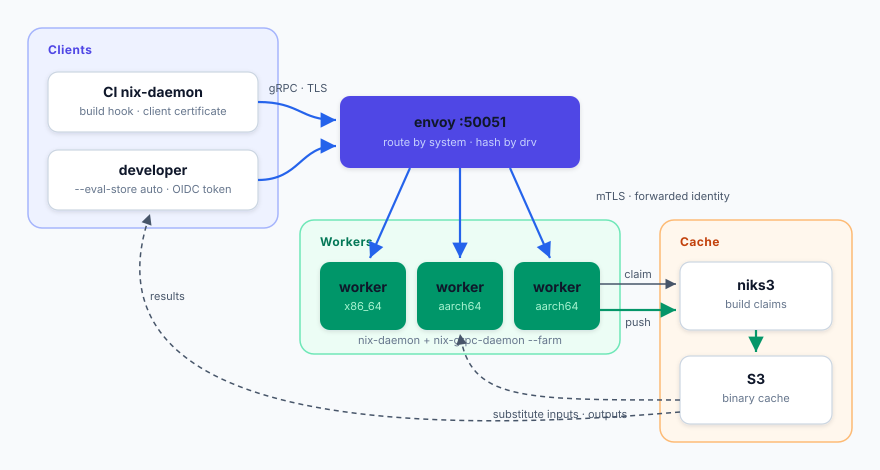
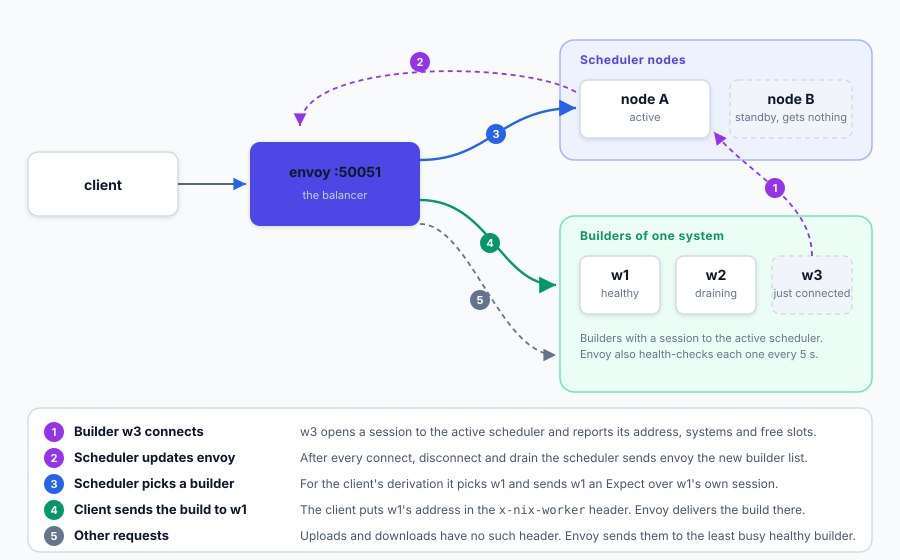

# Set up a build farm

A build farm is a group of workers behind one address. Clients send
builds to that address. The farm builds each derivation once even if
several clients ask for it, spreads the work over all workers, and
uploads the outputs to an S3 binary cache through
[niks3](https://github.com/Mic92/niks3).



This guide sets up the cache, the workers, the balancer and two kinds of
client, a CI host and a developer laptop, on NixOS. For the Helm chart
see [kubernetes.md](kubernetes.md).

## How it works

Every node runs `nix-grpc-daemon`. Its roles decide what the node does:

* A **builder** runs builds.
* A **scheduler** keeps the queue and decides which builder runs which
  derivation. Several nodes can have this role, but only one of them is
  active at a time. Another one takes over when the active one goes
  away.

By default a node has both roles and schedules onto itself, so it works
as a standalone machine.

Which nodes get the scheduler role depends on the farm:

* With a fixed set of machines, give it to one or two of the builders.
* With builders that an autoscaler adds and removes, give it to two or
  three small nodes that only schedule and that the autoscaler leaves
  alone.

What happens on a build:

1. Each builder keeps a connection to the scheduler open. Over this
   connection the builder reports its system, its features and how many
   builds it accepts.
2. The client opens a connection to the scheduler and lists the
   derivations it wants. The scheduler gives one of three answers for
   each derivation:

   | Answer | Meaning |
   |---|---|
   | *cached* | The outputs are already in the binary cache. |
   | *go to builder X* | That builder has a free slot. If several have one, the scheduler prefers the builder that already has the inputs. |
   | *no builder can take this* | No builder offers the system or a feature the derivation needs. |

3. The scheduler tells the builder which derivation to expect, and the
   client sends the build there. A builder rejects a build that the
   scheduler did not announce, and the client asks the scheduler again.
4. A second client that wants a derivation that is already building
   attaches to the running build.

The balancer (envoy) routes these requests. Scheduler traffic goes to
the active scheduler. Each build goes to the builder the scheduler
picked for it. Everything else (uploads, queries, downloads) is spread
over the builders of the right system.

When clients ask for more builds than the builders have slots, the
scheduler distributes the free slots as follows:

* A free slot goes to the user with the fewest builds running. A user is
  a certificate name or a token's subject.
* Among that user's `nix build` runs, the slot goes to the run with the
  fewest builds running.
* Within a run, derivations on the longest dependency chain are built
  first.

A small build therefore gets the next free slots, even while another
user has a whole system rebuild queued.

The scheduler is stateless. When it restarts, running builds continue.
Builders and clients reconnect, and clients ask again for the
derivations they are still missing.

When the scheduler shuts down cleanly, it notifies builders and clients,
and they reconnect immediately without printing a warning. After a crash
they detect the lost connection themselves and retry for two minutes.

A client may ask again before the builder that is working on its
derivation has reconnected. A second builder may then start the same
derivation. When the first builder reconnects, the scheduler stops the
second build and sends the clients to the first, so the derivation
produces one set of outputs.

With several scheduler-role nodes, the active one is the node that first
takes a lock in niks3's database. It stays active while it is connected.
When it goes away, another node takes the lock within seconds.

When a builder restarts, its builds fail and the scheduler assigns them
to other builders. A builder that only loses its connection to the
scheduler keeps building. The scheduler waits a minute for it to
reconnect before it starts those builds on another builder, or less if
a client reports that it cannot reach the builder.

When a client loses its connection, the builder keeps the build running
for a minute so that the client can reattach. Ctrl-C stops the build
immediately.

## Before you begin

You need:

* A [niks3](https://github.com/Mic92/niks3) instance, an S3 bucket
  behind it, and its API token and public signing key. A single node
  works without niks3 and then keeps the outputs in its own store.
* One or more NixOS machines per system type as builders, and the
  scheduler role on one or two of them or on separate small machines.
* One machine with a public DNS name for the balancer. It can also be a
  worker.
* A small private CA. It signs three kinds of certificate:

  | Certificate | CN | Used by |
  |---|---|---|
  | client cert | `ci-<host>` | each CI host, towards the balancer |
  | node cert | `worker-<host>`, SAN = address envoy dials | each node as its server cert, and as its client cert towards the scheduler |
  | balancer cert | `lb-<host>` | envoy, towards the nodes |

  The client cert is the same as for a standalone `nix-grpc-daemon`, so
  existing ones keep working. The other two secure the connections that
  the balancer adds. Envoy terminates the client's TLS and passes the
  client's identity on in a header, and the nodes only accept that
  header from a peer with a balancer cert (`trustedProxies`). The
  balancer's public listener uses a regular ACME certificate, so clients
  verify it with the system CA bundle. Nodes that reach the scheduler
  through that listener accept it too, because they check the scheduler
  against the private CA and the system CA bundle.

All modules below come from `nix-grpc-store.nixosModules.default`.

## Step 1: Configure the nodes

```nix
services.nix-grpc-daemon = {
  enable = true;
  listen = "[::]:50052";
  advertise = "10.0.0.5:50052";
  roles = [ "builder" ];              # [ "builder" "scheduler" ] on the scheduler node
  scheduler = "10.0.0.4:50052";       # leave out on the scheduler node itself
  idleTimeout = null;
  minFree = "20G";
  tls = {
    certFile = "/run/keys/worker.crt";
    keyFile = "/run/keys/worker.key";
    clientCaFile = "/run/keys/farm-ca.crt";
  };
  trustedProxies = [ "lb-*" ];
  accessRules = [
    { cn = "ci-*"; role = "trusted"; }
    { cn = "worker-*"; role = "trusted"; }
    { cn = "lb-*"; role = "trusted"; }   # the balancer, to read the builder list
  ];
  niks3 = {
    package = pkgs.niks3;
    url = "https://niks3.example.com";
    tokenFile = "/run/keys/niks3-token";
    cacheUrl = "https://cache.example.com";
    publicKeys = [ "cache.example.com-1:…" ];
  };
};
```

| Option | Meaning |
|---|---|
| `roles` | `builder`, `scheduler` or both (the default). Only fixed machines should have `scheduler`. |
| `scheduler` | Where a builder finds the scheduler: that node's address, or the balancer's when several nodes have the role (see [failover](#managing-the-farm)). Unset on a node that is the only scheduler. |
| `advertise` | The address the balancer reaches this node at. For a builder it must be `IP:port`, since the scheduler passes it to envoy as an endpoint. The address is only used for routing and grants no access. Only peers with the `trusted` role can open a session. For a scheduler node it must match its entry in the balancer's `scheduler`. |
| `maxJobs` | Concurrent builds. Defaults to the local nix-daemon's `max-jobs`. |
| `lookupThreads` | Cache lookups a scheduler runs at once for incoming build requests, 32 by default. Raise it when requests wait on a slow cache while the scheduler is idle. |
| `minFree` | When less disk space than this is free, the node stops accepting builds until space is free again. |
| `buildLogRetention` | How long a builder keeps Nix's build logs, `"30d"` by default. `null` keeps them forever, as Nix does. |
| `trustedProxies` | Peers with a matching client cert are balancers. The node takes the real client identity from the `x-forwarded-client-cert` header they set. The node ignores the header from other peers. |
| `accessRules` | Maps CNs to roles. CI needs `trusted`, and so do the other nodes for their connection to the scheduler. |
| `schedulerTokenFile` | Bearer token for the connection to the scheduler, instead of or next to the client certificate. The scheduler node maps it to `trusted` through its `oidc` rules. |
| `niks3.tokenFile`, `niks3.clientCertFile` | How the node authenticates to niks3: a bearer token, a client certificate (defaults to `tls.certFile`), or both. |
| `workerName` | Name clients see in `worker: building …` lines and in `nix_grpc_build_info`. Defaults to the hostname. |

Repeat for every node. Builders for different systems use the same
config. `nix.settings.system-features` decides which
`requiredSystemFeatures` a builder accepts. A derivation that needs
`kvm` only goes to builders that list it. A builder also accepts the
systems in `nix.settings.extra-platforms` (binfmt, Rosetta) and in
`extraSystems` (e.g. ones the nix-daemon hands to `external-builders`).
Add each of them to the balancer's `systems`. A scheduler-only node uses
the same config with `roles = [ "scheduler" ]` and without `scheduler`,
`maxJobs` and `minFree`.

A node opens two outbound connections, to the scheduler and to niks3.
On each it authenticates with its certificate, a bearer token, or both:

| Connection | Certificate | Token |
|---|---|---|
| scheduler | `tls.certFile` | `schedulerTokenFile` |
| niks3 | `niks3.clientCertFile` (defaults to `tls.certFile`) | `niks3.tokenFile` |

The config above uses the certificate for both connections and also
sends the niks3 API token.

A farm without its own CA uses OIDC tokens. Set `schedulerTokenFile` and
`niks3.tokenFile` on every node, and add an `oidc` rule on the scheduler
node that grants those tokens `trusted`.

If a node presents both a certificate and a token, the certificate takes
precedence.

The connection to the scheduler uses TLS unless `scheduler` is written
as `http://host:port`.

Builds run in `nix-daemon.service`, while RPCs and downloads run in
`nix-grpc-daemon.service`. The module gives `nix-grpc-daemon.service`
`CPUWeight = 1000` and `MemoryMax = "2G"`, so RPCs stay responsive
during a heavy build. Both are defaults that
`systemd.services.nix-grpc-daemon.serviceConfig` overrides.

### Optional: update nodes without a rebuild

With [flakelet](https://github.com/Mic92/flakelet) on the host, the daemon
can run from this flake instead of the host's system closure:

```nix
imports = [ flakelet.nixosModules.flakelet ];
services.nix-grpc-daemon.flakelet.enable = true;
# optional: follow main, and what used to be systemd.services.….serviceConfig
services.flakelets.services.nix-grpc-daemon = {
  autoUpdate.enable = true;
  settings.serviceConfig.MemoryMax = "16G";
};
```

The other options stay as above and become the flakelet's settings.
`package` and `niks3.package` are ignored because the flakelet builds
both. `flakelet update nix-grpc-daemon` then drains the builder and
starts the new version, and `flakelet disable nix-grpc-daemon` takes the
node out of the farm until `flakelet enable`. This state survives
rebuilds and reboots.

### Optional: accept developer tokens

To let people without a client certificate use the farm, add an OIDC
provider. The schema matches niks3's `--oidc-config`.

```nix
services.nix-grpc-daemon.oidc.providers.sso = {
  issuer = "https://auth.example.com/realms/internal";
  audience = "nix-farm";
  rules = [ { bound_claims.groups = [ "developers" ]; scopes = [ "write" ]; } ];
};
```

`write` lets a token holder request builds. Uploading
unsigned paths and the worker-protocol tunnel need `trusted`.

## Step 2: Configure the balancer

```nix
services.nix-grpc-farm-lb = {
  enable = true;
  listen = "[::]:50051";
  systems = [ "x86_64-linux" "aarch64-linux" ];
  scheduler = "10.0.0.4:50052";
  tls = {
    certFile = "/var/lib/acme/farm.example.com/fullchain.pem";
    keyFile  = "/var/lib/acme/farm.example.com/key.pem";
    clientCaFile = "/run/keys/farm-ca.crt";
    upstream = {
      certFile = "/run/keys/lb.crt";
      keyFile  = "/run/keys/lb.key";
      caFile   = "/run/keys/farm-ca.crt";
    };
  };
};
security.acme.certs."farm.example.com".group = "envoy";
```

The balancer, the workers and the scheduler load renewed certificates
from disk without a restart.

| Option | Meaning |
|---|---|
| `systems` | The systems the farm builds for. Requests for a system not listed go to `defaultSystem` (first entry by default). Builders appear when they connect to the scheduler and disappear when they leave. |
| `scheduler` | The node(s) with the `scheduler` role, as in their `advertise`. With several nodes, envoy sends scheduler calls to the active one and reads the builder list from it. |
| `tls.certFile`/`keyFile` | Public server certificate. |
| `tls.clientCaFile` | Verify client certificates against this CA and forward the subject to workers. Clients without a certificate are still accepted so tokens work. |
| `tls.upstream.*` | The certificate envoy presents to workers, and the CA to verify them. |



A builder is in envoy's list while its session with the active scheduler is
open. Envoy still health-checks each one, and a builder that is draining
gets no new requests.

To check that envoy sees your workers:

```console
$ curl -s localhost:9901/clusters | grep health_flags
x86_64-linux::10.0.0.4:50052::health_flags::healthy
aarch64-linux::10.0.0.5:50052::health_flags::healthy
sched::10.0.0.4:50052::health_flags::healthy
```

The `workers` option from earlier versions still evaluates with a
warning, and its addresses are ignored.

`accessLog = true` adds a journal line per connection with the client
certificate subject and, for failed TLS handshakes, the reason.

## Step 3: Connect a CI host

The CI host's nix-daemon uses the farm through the standard build hook.

```nix
programs.nix-grpc-store.enable = true;
nix.distributedBuilds = true;
nix.buildMachines = map (system: {
  hostName = "grpc://farm.example.com:50051?system=${system}&client-cert=/run/keys/ci.crt&client-key=/run/keys/ci.key";
  protocol = null;
  inherit system;
  supportedFeatures = [ "big-parallel" "kvm" "nixos-test" ];
  maxJobs = 64;
}) [ "x86_64-linux" "aarch64-linux" ];
```

Use one `buildMachines` entry per system. The `system=` parameter tells
the balancer which builders should receive the inputs the hook uploads
before the build, and which ones serve `builders-use-substitutes`
downloads.

The CI certificate needs the `trusted` role, since the hook uploads
locally built, unsigned store paths.

If `nix.firewall` restricts what `nix-daemon.service` may connect to,
port 50051 is already allowed. For a balancer on another port set
`programs.nix-grpc-store.daemonEgressPorts`.

To verify, build something uncached:

```console
$ nix build --max-jobs 0 --impure --expr '(import <nixpkgs> {}).runCommand "farm-test" {} "date > $out"'
building '/nix/store/…-farm-test.drv' on 'grpc://farm.example.com:50051?…'...
worker-1: building …-farm-test.drv
```

## Step 4: Connect a developer laptop

Developers authenticate with a token instead of a certificate and
evaluate locally:

```console
$ nix build --store 'grpc://farm.example.com:50051?token-file=./jwt' --eval-store auto .#pkg
```

`--eval-store auto` keeps evaluation and the `.drv` files on the
laptop. Nix hands the whole dependency graph to the farm in one go, so
independent derivations build on different builders in parallel.

The outputs end up in the cache. To fetch them into the local store:

```console
$ nix copy --from https://cache.example.com $(nix build … --print-out-paths)
```

A small wrapper script can fetch the token and run `nix build`, for
example as `nix run .#nix-farm`. An OIDC device-code login takes a few
lines of `curl`.

## Managing the farm

**Add a builder.** Deploy it with the Step 1 config. The balancer learns
about the new builder from the scheduler, and the builder takes queued
builds as soon as it has connected.

**Autoscale builders.** `nix_grpc_sched_system` has one series per
system and feature set. `queued` and `unplaceable` are labelled with
what the derivations require (`features=""` for none, otherwise sorted
and comma-joined like `features="big-parallel,kvm"`). `running`,
`workers`, `slots` and `free` are labelled with what the builders offer,
under their native system. So a plain x86_64 group scales on
`{system="x86_64-linux",features=""}` and a kvm group on
`{system="x86_64-linux",features="kvm"}` independently. `unplaceable`
counts queued builds that no connected builder could take at all, so a
group does not grow for builds it cannot run. Scale a group on `queued -
unplaceable` for its label set. Scaling down drains the builder, see
below. [kubernetes.md](kubernetes.md#autoscale-a-worker-group) has a
KEDA example.

**Drain a builder.** `systemctl stop nix-grpc-daemon` makes the builder
stop accepting builds and return the assignments that no client has
claimed yet to the scheduler. The command returns once the claimed
builds have published their outputs. After `TimeoutStopSec` (1h) the
remaining builds are killed and their clients are sent to another
worker. A second SIGTERM cancels the builds immediately. `nixos-rebuild
switch` only signals the worker, and the next connection starts the new
generation.

**Restart the scheduler.** This is safe at any time, see [How it
works](#how-it-works). New builds wait until it is back, or until
another scheduler node has taken over.

**Scheduler failover.** Give the `scheduler` role to two or three fixed
nodes and list them all in the balancer's `scheduler`. If those nodes
also build, set their `scheduler` to the balancer's address so their
builder side follows whichever one is active. niks3 picks the active
one, and each node logs `scheduler_take_over` / `scheduler_yield` when
that changes.

**See what a worker did.** Each build is one journal line:

```
event=rpc method=BuildDerivation cn=ci-build01 duration_s=42 …
```

The scheduler logs which builder got each build and how the build ended,
including builds that failed or were given back:

```
event=assigned drv=/nix/store/…-foo.drv assign_id=7 addr=10.0.0.5:50052 clients=1
event=done drv=/nix/store/…-foo.drv assign_id=7 addr=10.0.0.5:50052 outcome=FAILED
```

Set `logLevel = "debug"` on the scheduler to also log each request.

**Metrics.** Set `services.nix-grpc-daemon.metricsListen` on the nodes
and scrape envoy's admin port (`/stats/prometheus`). The README lists
the [metrics](../README.md#prometheus-metrics). Only the active
scheduler reports non-zero scheduler metrics, so aggregate them with
`max` over the scheduler nodes. The flake ships a Grafana dashboard as
`nix-grpc-store.dashboards.farm`:

```nix
services.grafana.provision.dashboards.settings.providers = [{
  name = "nix-farm";
  options.path = pkgs.linkFarm "dashboards" { "farm.json" = inputs.nix-grpc-store.dashboards.farm; };
}];
```


The `prefix` and `instance` variables at the top adapt the dashboard to
pipelines that rename metrics or labels. For telegraf the prefix is
`prometheus_` and the worker label `host`. On Kubernetes set `instance`
to `pod` or `node`.

## Troubleshooting

### `… pass --eval-store auto`

You ran `nix build --store grpc://…` without `--eval-store auto`, so the
derivations only exist in your local store.

### `TLS handshake failed` / `could not reach the server`

Rerun with `NIX_GRPC_DEBUG=1` (for the build hook, put it in
`systemd.services.nix-daemon.environment`) to see which CA bundle and
client certificate were loaded plus gRPC's handshake trace. On the
balancer, `accessLog = true` shows the same connection from the server
side.

### `server requires a TLS client certificate or bearer token`

The request reached a worker with neither a forwarded certificate nor a
token. Check that the client passes `client-cert`/`client-key` or
`token-file`, and that envoy's `tls.clientCaFile` is set.

### `no access rule matches '<cn>'`

The certificate verified but its CN isn't in `accessRules`.

### `no connected, non-draining worker for system … offers features {…}`

No builder for that system (with those `system-features`) is connected
to the scheduler, or all of them are low on disk, stopping, or have a
local nix-daemon that does not answer. Each builder reports the reason
in `nix_grpc_unavailable{reason="stopping|low_disk|local_daemon"}` and
in its journal (`event=unhealthy`). The client prints this as a warning
and waits two minutes before giving up, because right after a scheduler
restart the builders may still be reconnecting. Look for
`event=scheduler_disconnected` in the builders' journal.

### Builds wait although a builder has free slots

When a builder gives back three builds in a row because of a failure of
its own (for example a full build directory), the scheduler pauses it
for 30 seconds. Each further failure doubles the pause, up to ten
minutes. The pause ends automatically, and a finished build or a restart
of the builder resets the count. The scheduler's journal shows which
builder it is (`event=rested reason=failing addr=…`) and
`nix_grpc_sched{kind="rested"}` counts such builders. That builder's
journal shows the cause.

### `asking the scheduler again` keeps repeating

The client reaches a different worker than the scheduler picked. The
`advertise` of a worker differs from the address envoy uses to reach it.

### A worker shows `failed_active_hc`

The worker is stopping, or envoy fails the mTLS handshake with it. Check
`journalctl -u nix-grpc-daemon` on the worker.