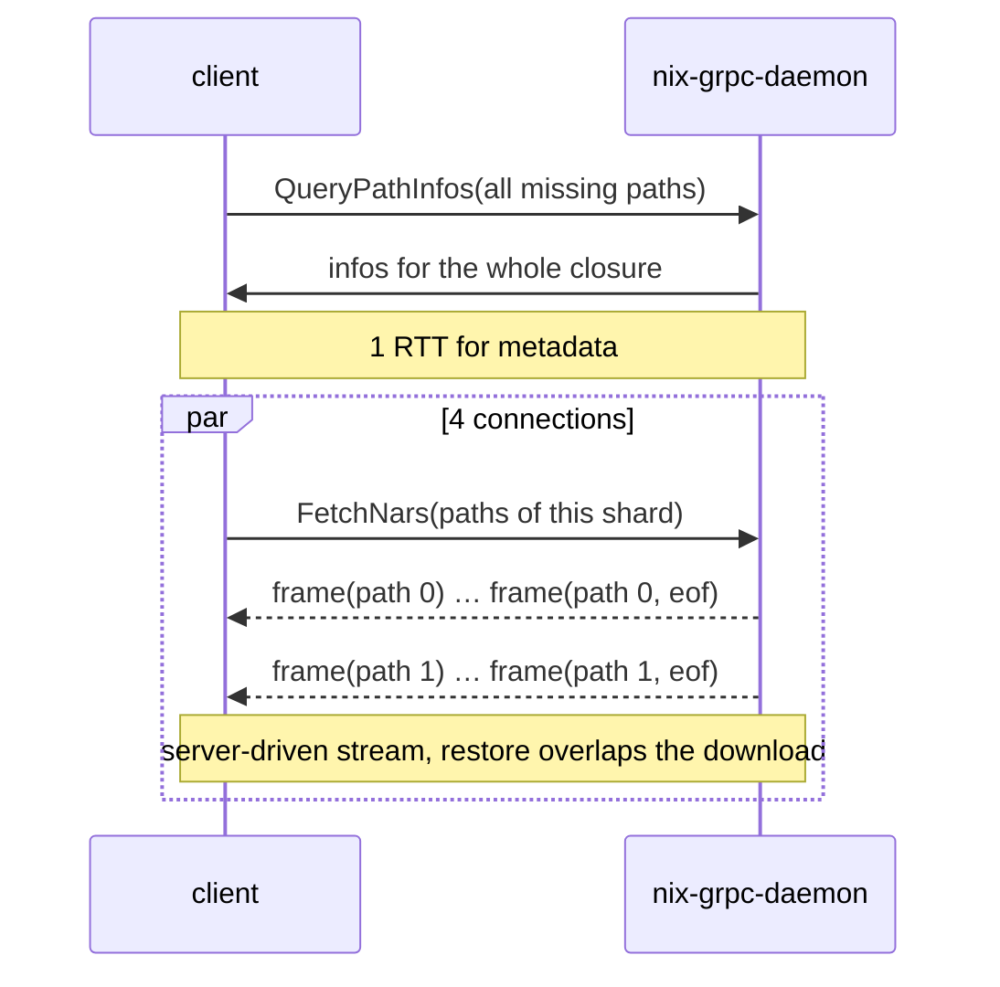
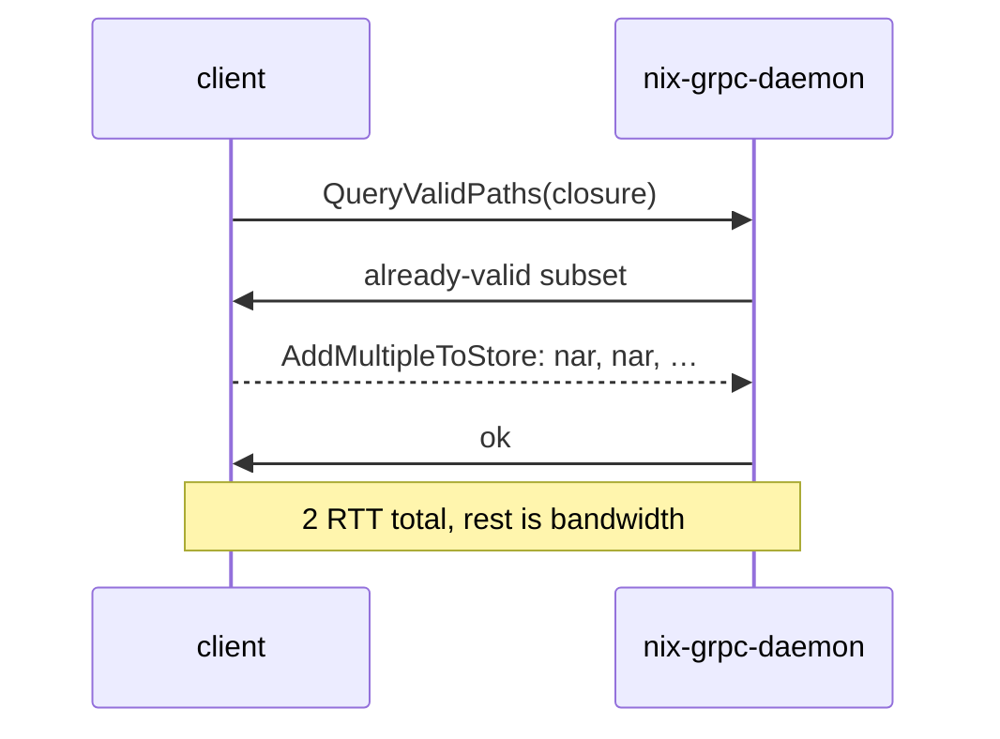
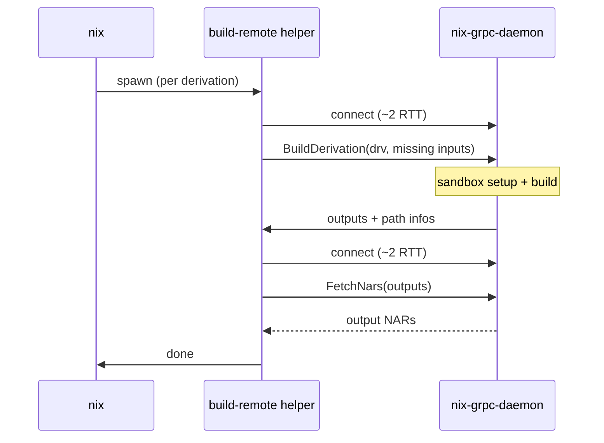
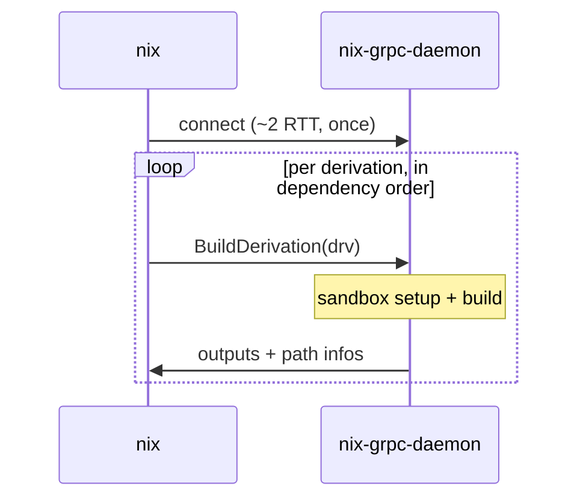

# Protocol latency

Each operation below is shown with its round trips. Every arrow pair
that must complete before the next step costs one RTT (~50 ms on the
benchmark link).

A fresh connection costs about 2 RTT (TCP, TLS 1.3, HTTP/2 preface).
Channels are long-lived, so most operations pay this once.

## Substitution (`nix copy --from grpc://…`)

A batched RPC fetches the path infos for the whole closure. Downloads
use one `FetchNars` stream per TCP connection (default 4). The client
sends the paths of each shard once and the server streams zstd frames
tagged with a path index. NARs are restored while later ones are still
in flight.

Total: connection setup + 1 RTT + transfer time. `ssh-ng://` instead
queries and fetches each path in turn over a single channel and pays
round trips per path.

## Upload (`nix copy --to grpc://…`)

An `AddMultipleToStore` stream carries all NARs back to back. The
server answers once at the end.

## Remote build, hook mode (`builders = grpc://…`)

Nix spawns a `build-remote` helper for every derivation. Each helper
opens its own connections, so every derivation pays the connection setup
again.

Per derivation: helper spawn + ~4 RTT of connection setup + 2 RPCs + the
build itself. `ssh-ng://` follows the same sequence, but each connect is
a full ssh session and the tunnelled worker protocol adds further round
trips.

## Remote build, direct mode (`nix build --store grpc://…`)

The same client process drives the whole build graph over the same
channel. Outputs stay on the remote store instead of being copied back.

Per derivation: 1 RTT + the build itself. The build on the server
dominates, which is why the transports converge in this mode.
